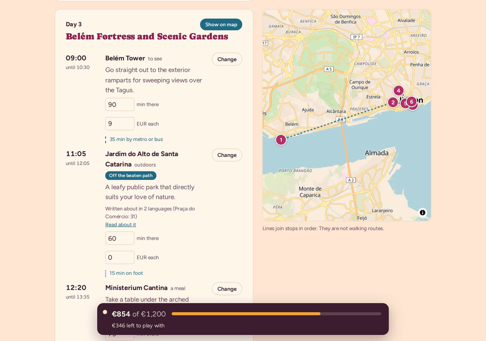
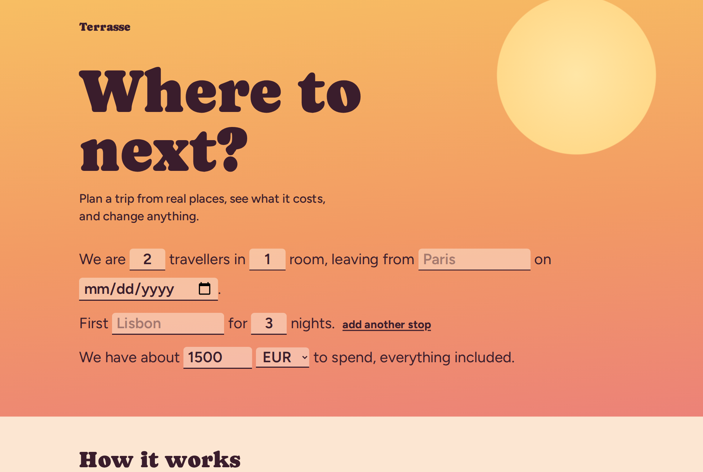
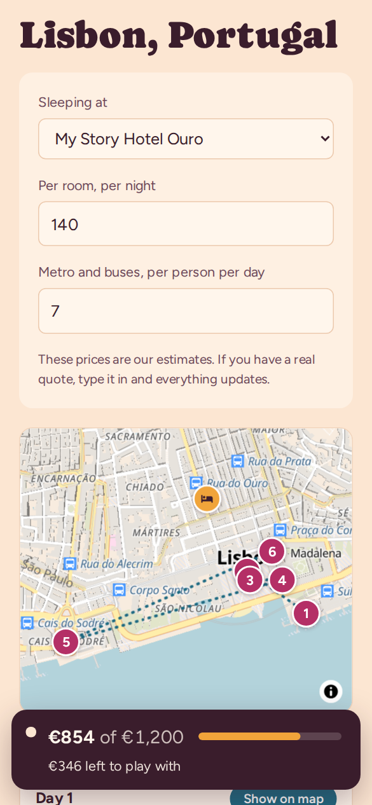

# Terrasse: an AI trip planner that only uses real places

Tell it who's travelling, where to, for how long and on what budget. It builds a day-by-day plan
from **places that actually exist**, puts each day on a map, and shows what it costs. Then you can
change anything, and times and money update instantly.



*A real plan for 3 nights in Lisbon, generated by the app. Day 3 starts at Belém Tower and works back
towards the centre. The bar at the bottom is the live budget.*

## The core idea

Language models are good at arranging things and bad at facts and arithmetic. Ask one for a trip
and it may send you to a restaurant that closed years ago, then add the bill up wrong. So the work
is split:

| Job | Who does it | Why |
|---|---|---|
| Find places | Map data (Geoapify, OpenStreetMap) and Wikidata | They exist, with real coordinates |
| Decide which places, in what order, for how long | The AI (Google Gemini) | This is the part it's good at |
| Check the AI's answer | Code | Any place the AI names that we didn't give it is **dropped** |
| Clock times, travel between stops, every total | Code | Correct every time, and instant when you edit |

The AI receives a list of about 70 real candidate places, each with an id. It may only answer with
those ids, its answer must match a strict schema, and anything else is thrown away before you see it.

## What it does

- **Plans whole trips:** several travellers and rooms, several cities, journeys between them and home.
- **Knows what's famous, measurably.** Fame is the number of Wikipedia languages that write about a
  place (from Wikidata), never the AI's opinion. Must-sees up to 20 km away are found even when the
  map data misses them (the Brooklyn Bridge isn't tagged as a tourist place in OpenStreetMap).
- **Finds lesser-known places too:** viewpoints, murals, markets, bookshops, small museums, labelled
  "Off the beaten path" or "Local find". A Classic / Balanced / Adventurous choice sets the mix.
- **Lets you edit everything:** move, swap, add or remove stops, change durations, prices or the
  hotel. Only the city you change gets re-planned.
- **Shows each day on a map** with numbered stops in visiting order.
- **Is honest about money:** every price is labelled as an estimate, and every one is editable.

<p align="center">
  
  &nbsp;
  
</p>

## How it works

```
browser                                  server  (POST /api/plan-leg, once per city)
───────                                  ────────────────────────────────────────────
trip details  ─────────── request ────▶  1. find the city on the map               Geoapify
                                         2. collect real places by category         Geoapify
                                         3. measure how famous each one is          Wikidata
                                         4. ask the AI to arrange them, by id       Gemini
                                         5. validate the answer, repair once        Zod
                                         6. drop any id we didn't supply            grounding
day-by-day plan  ◀──────── reply ──────
  │
  └─ every edit: times and budget recalculated in the browser (no network, no AI)
```

## Problems worth mentioning

Things that broke with real data, and how they were fixed:

- **Countries and regions failed.** "Morocco" or "Tuscany" geocode to their centre point, often in
  empty countryside, so planning failed with "too few places". Now they get a clear message, and
  "New York" (which first matches the state) is resolved to the city.
- **The map data misses icons.** The 60 nearest sights in Manhattan were all within 632 m of the
  centre, and 87% of New York viewpoints had no name. Famous places now come from a separate
  Wikidata search, and the app only asks for named places.
- **A landmark placed in the wrong spot.** Searching "Belém Tower, Lisbon, Portugal" made the
  geocoder fall back to the city itself, putting the tower in the city centre, 7 km from where it
  stands. The app now searches the name alone near the city, and rejects any answer that is a whole
  city or district.
- **The AI is sometimes unavailable.** Google retires model names, rate-limits free keys and returns
  "overloaded" errors. The app retries overloads with pauses, explains quota errors in plain words,
  and makes the model a setting.
- **Hardening.** Per-visitor and site-wide daily limits on AI calls, a locked health-check route,
  a Content Security Policy, and patched dependencies (`npm audit` is clean for what ships).

## Tech

Next.js 16 (App Router) · React 19 · TypeScript · Zod 4 · MapLibre GL · Google Gemini ·
Geoapify (OpenStreetMap) · Wikidata · Node's built-in test runner (70 tests) · GitHub Actions
(typecheck, lint, test and build on every push).

No database and no accounts: trips are saved in the browser.

## Run it yourself

You need Node.js 20.12+ and two free API keys (no credit card): [Geoapify](https://www.geoapify.com)
and [Google AI Studio](https://aistudio.google.com).

```bash
cd web
npm install
cp .env.example .env.local    # paste the two keys
npm run dev                   # http://localhost:3000
```

More detail, including troubleshooting, in [`web/README.md`](web/README.md).

## Repository

| Folder | What's in it |
|---|---|
| [`web/`](web/) | **The app.** Pages, API routes, planning logic and tests |
| [`docs/`](docs/) | Design notes (map, discovery), the public-launch plan, the original project plan |
| [`prototype/`](prototype/) | Archived first version: a command-line tool that proved the core idea |

Places data © [OpenStreetMap contributors](https://www.openstreetmap.org/copyright), via Geoapify.
Fame data from [Wikidata](https://www.wikidata.org/) (CC0).
